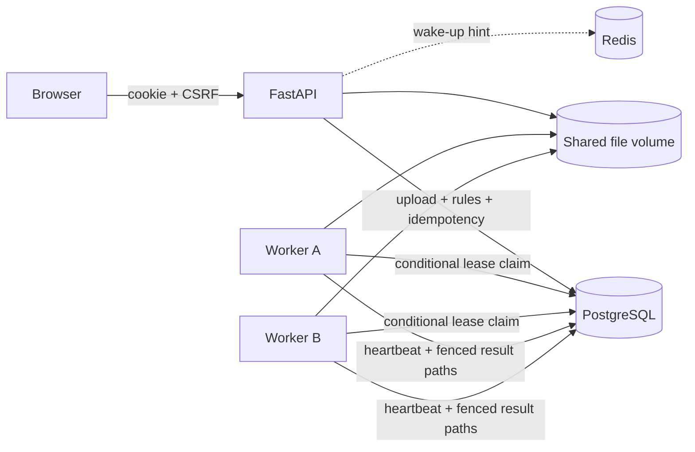

# Design and failure behavior

## State transitions

`queued → running → completed`

`running → queued` for retryable failures; delayed by 2^attempt seconds.

`running → running` when an expired lease is reclaimed with a new token.

`running → failed` for deterministic input failures or exhausted attempts.

`queued/running → cancelled`; `failed/cancelled → queued` for manual retry.

Every state change that affects ownership uses an atomic conditional UPDATE. Claims recheck status, deadline, and attempt budget in the write, rather than trusting the earlier SELECT. Progress, heartbeats, error handling, and publication require the matching lease token, running state, and a still-valid lease. A worker cannot resurrect a cancelled or reclaimed job.

## Why this architecture?

The SQL table is the durable queue. Keeping job acceptance and enqueueing in the same database transaction eliminates the common window where a database insert succeeds but a broker publish fails. Redis speeds idle discovery, and polling recovers missed notifications. Each worker runs one job at a time; horizontal workers supply bounded parallelism. CSV processing stays out of the API process.

There is no checkpoint-resume promise. Each attempt restarts the source file from row one so validation and deduplication remain deterministic. Progress resets on recovery. At-least-once execution is acceptable because output files are attempt-local and become visible only through a fenced database publication. Multiple incomplete attempts are never concatenated.

## Failure matrix

| Failure | Result |
|---|---|
| API dies before job commit | No accepted job; uncommitted input may need cleanup |
| API dies after commit, before Redis hint | DB polling finds the job |
| Redis unavailable | Polling continues |
| Worker SIGKILL | Lease expires; another worker restarts file |
| Stale worker returns | Token/deadline check rejects its writes |
| Cancellation during processing | Token revoked; no partial download published |
| Worker dies after files close, before DB publication | Another attempt reprocesses; abandoned directory may remain |
| Duplicate client request | Same owner/key/fingerprint returns same job |
| Same key, different payload | 409 conflict |
| Invalid header/encoding | Terminal failure with readable reason |
| Result volume lost | Download returns 410; DB does not fabricate a file |
| Database unavailable | API health fails; worker logs error and retries loop |

## Admission and previews

Uploads and manual retries acquire a write lock on the owner row before checking active-job capacity. PostgreSQL serializes requests for the same owner; SQLite uses its writer lock. This prevents concurrent requests from exceeding the 20-job limit. Idempotency is checked inside that lock before capacity, so an existing job can be returned even when the account is full.

Result previews use the same owner check as downloads and expose at most 10 rows, 12 columns, and 200 characters per cell. The source result files remain complete. Preview text is escaped before HTML rendering.

## Resource boundaries

Files are bounded, processed in a stream, and results are written incrementally. Deduplication maintains up to 200,000 row tuples in memory; it is not constant-memory deduplication. Database progress is batched (250 rows by default), and heartbeat writes run separately. Files are UUID-named; user filenames are display/download metadata only. Download paths never come from request path traversal.

## Deployment tradeoffs

Default local mode: SQLite WAL, separate API and worker processes. PostgreSQL Compose mode adds concurrency headroom and an independent service. Database initialization creates the v0.1 schema; future changes require migrations. File storage must be shared with all workers. This design is suited to a single host or a small cluster with shared storage; moving to S3 needs an explicit artifact manifest and lifecycle policy.

Session lifetime is 24 hours. Credentials are hashed, random session secrets are stored as SHA-256 digests, cookies are HttpOnly/SameSite Lax, CSRF tokens are required for authenticated writes, and browser cross-origin writes are rejected. Set secure cookies under HTTPS. The frontend uses escaped text for user content and a same-origin content security policy.
